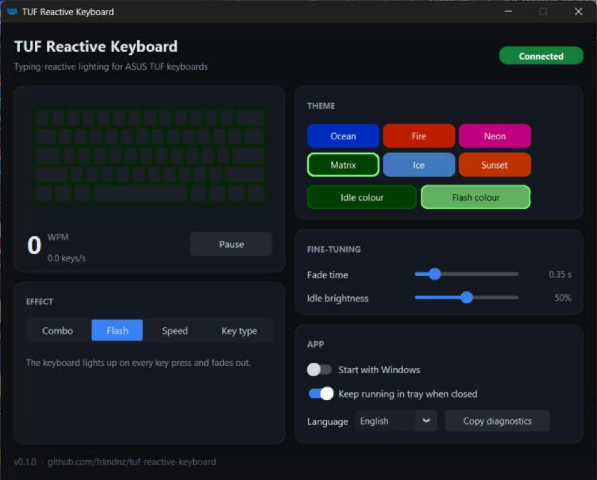

<p align="center">
  
</p>

<h1 align="center">TUF Reactive Keyboard</h1>

<p align="center">
  Typing-reactive RGB lighting for <b>ASUS TUF</b> laptops with a single-zone RGB keyboard.<br>
  <a href="README.tr.md">Türkçe</a> ·
  <a href="https://github.com/frkndnz/tuf-reactive-keyboard/releases/latest">Download</a> ·
  <a href="https://github.com/frkndnz/tuf-reactive-keyboard/issues/new?template=model_report.yml">Report your model</a>
</p>

<p align="center">
  
</p>

Most TUF laptops have a **1-zone RGB** keyboard: every key shares one colour, so per-key effects like
ripples are impossible in hardware. Armoury Crate only offers static, breathing and colour-cycle modes.
This small app makes the whole keyboard **react to your typing** instead.

## Effects

| Effect | What it does |
| --- | --- |
| **Combo** | Colour follows your typing speed and flashes on every key press |
| **Flash** | The keyboard lights up on each key press and fades out |
| **Speed** | Blue when you type slowly, shifting through purple and pink to red as you speed up |
| **Key type** | Letters, digits, space, Enter and delete keys flash in different colours |

Plus: six colour themes and custom colours, adjustable fade time and idle brightness, live keyboard preview
with a WPM meter, system tray icon, *Start with Windows*, saved settings, and Turkish/English UI.

## Install

### Option 1 – ready-made `.exe`
Download `TUFReactiveKeyboard.exe` from the [latest release](https://github.com/frkndnz/tuf-reactive-keyboard/releases/latest) and run it.
Windows SmartScreen may warn because the file is not code-signed. Click **More info → Run anyway**, or use option 2.

### Option 2 – from source
Requires Windows 10/11 and [Python 3.10+](https://www.python.org/downloads/).

```bat
git clone https://github.com/frkndnz/tuf-reactive-keyboard.git
cd tuf-reactive-keyboard
run.bat
```

`run.bat` installs the requirements on first launch and starts the app without a console window.

## Supported laptops

| Model | Status |
| --- | --- |
| ASUS TUF Gaming F15 (FX507ZC4) | ✅ Works |

Other TUF models with 1-zone RGB (FX506, FX507, FA506, FA507, FX517…) will probably work too.
**Please [report your model](https://github.com/frkndnz/tuf-reactive-keyboard/issues/new?template=model_report.yml)**,
using the app's *Copy diagnostics* button, so this list can grow.

## How it works

- A low-level Windows keyboard hook notices key presses.
- The engine turns presses and typing speed into a colour, up to 20 updates per second.
- The colour is sent through ASUS's **ATKACPI** driver, the same interface used by
  [G-Helper](https://github.com/seerge/g-helper) and the Linux `asus-wmi` driver.
  If that fails, the app falls back to the **ASUS Aura SDK**.

## Privacy

The app only uses *that* a key was pressed and the key's category (letter, digit, space…).
**Keystrokes are never stored, logged or sent anywhere.** There is no network code.
Settings are saved to `%APPDATA%\tuf-reactive-keyboard\config.json`.

## Is it safe for the keyboard?

- Colours are sent with the "apply" command (`0xB3`), never the "save to BIOS" command (`0xB4`),
  so nothing is written to firmware memory. A reboot restores your previous lighting.
- Rapid colour changes don't wear out LEDs. The app spends most of its time at low brightness.

> [!WARNING]
> ATKACPI is not an officially documented ASUS interface. It has been used safely by other tools for years,
> but this project comes with no warranty. Use at your own risk.

## FAQ

**The status says "Preview only".** The keyboard could not be reached. Run the app as administrator once.
If it still fails, open an issue with the diagnostics.

**Armoury Crate lighting stopped working.** The app controls the lighting while it runs. Pause it or quit
from the tray icon to give control back.

**Can it do per-key effects like ripples?** Not on 1-zone keyboards. That is a hardware limit.

## Contributing

Issues and pull requests are welcome, especially compatibility reports and new effects.
Effects live in [`effects.py`](tuf_reactive_keyboard/effects.py), keyboard backends in [`backends.py`](tuf_reactive_keyboard/backends.py).

## License

[MIT](LICENSE) © frkndnz. Not affiliated with ASUS. "ASUS", "TUF" and "Aura" are trademarks of ASUSTeK Computer Inc.
