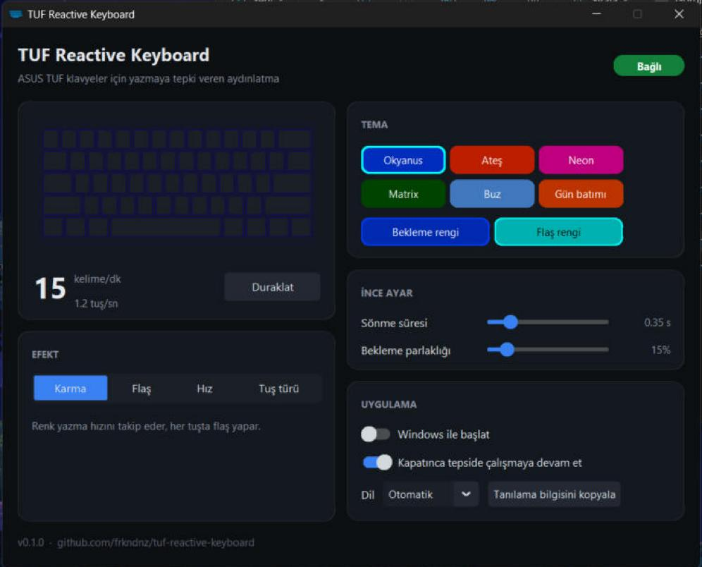

<p align="center">
  
</p>

<h1 align="center">TUF Reactive Keyboard</h1>

<p align="center">
  Tek bölgeli RGB klavyeye sahip <b>ASUS TUF</b> dizüstüleri için yazmaya tepki veren aydınlatma.<br>
  <a href="README.md">English</a> ·
  <a href="https://github.com/frkndnz/tuf-reactive-keyboard/releases/latest">İndir</a> ·
  <a href="https://github.com/frkndnz/tuf-reactive-keyboard/issues/new?template=model_report.yml">Modelini bildir</a>
</p>

<p align="center">
  
</p>

Çoğu TUF dizüstünün klavyesi **tek bölgeli RGB**. Bütün tuşlar aynı rengi paylaşır, bu yüzden dalga gibi
tuş başına efektler donanım olarak mümkün değil. Armoury Crate de sadece sabit, nefes ve renk döngüsü sunuyor.
Bu küçük uygulama bunun yerine bütün klavyenin **yazmana tepki vermesini** sağlıyor.

## Efektler

| Efekt | Ne yapar |
| --- | --- |
| **Karma** | Renk yazma hızını takip eder, her tuşta flaş yapar |
| **Flaş** | Her tuşa basışta klavye parlar ve yavaşça söner |
| **Hız** | Yavaş yazarken mavi, hızlandıkça mor ve pembeden kırmızıya kayar |
| **Tuş türü** | Harf, rakam, boşluk, Enter ve silme tuşları farklı renkte flaş yapar |

Ayrıca: altı renk teması ve özel renkler, ayarlanabilir sönme süresi ve bekleme parlaklığı, kelime/dakika
göstergeli canlı klavye önizlemesi, sistem tepsisi simgesi, *Windows ile başlat*, kaydedilen ayarlar,
Türkçe ve İngilizce arayüz.

## Kurulum

### 1. yol – hazır `.exe`
[Son sürümden](https://github.com/frkndnz/tuf-reactive-keyboard/releases/latest) `TUFReactiveKeyboard.exe` dosyasını indir ve çalıştır.
Dosya kod imzalı olmadığı için Windows SmartScreen uyarı verebilir. **Ek bilgi → Yine de çalıştır**'a tıkla ya da 2. yolu kullan.

### 2. yol – kaynak koddan
Windows 10/11 ve [Python 3.10+](https://www.python.org/downloads/) gerekir.

```bat
git clone https://github.com/frkndnz/tuf-reactive-keyboard.git
cd tuf-reactive-keyboard
run.bat
```

`run.bat` ilk açılışta gerekli paketleri kurar ve uygulamayı konsol penceresi olmadan başlatır.

## Desteklenen modeller

| Model | Durum |
| --- | --- |
| ASUS TUF Gaming F15 (FX507ZC4) | ✅ Çalışıyor |

Tek bölgeli RGB'ye sahip diğer TUF modellerinde (FX506, FX507, FA506, FA507, FX517…) de büyük ihtimalle çalışır.
Uygulamadaki *Tanılama bilgisini kopyala* düğmesini kullanarak
**[modelini bildir](https://github.com/frkndnz/tuf-reactive-keyboard/issues/new?template=model_report.yml)**, böylece liste büyüsün.

## Nasıl çalışır

- Windows klavye kancası tuşa basıldığını fark eder.
- Motor, basışları ve yazma hızını bir renge çevirir. Saniyede en fazla 20 güncelleme gönderir.
- Renk, ASUS'un **ATKACPI** sürücüsü üzerinden gönderilir. Bu, [G-Helper](https://github.com/seerge/g-helper)
  ve Linux `asus-wmi` sürücüsünün kullandığı arayüzün aynısı. Olmazsa uygulama **ASUS Aura SDK**'ya geçer.

## Gizlilik

Uygulama sadece bir tuşa basıldığını ve tuşun türünü (harf, rakam, boşluk…) kullanır.
**Basılan tuşlar asla kaydedilmez ve hiçbir yere gönderilmez.** Uygulamada ağ kodu yoktur.
Ayarlar `%APPDATA%\tuf-reactive-keyboard\config.json` dosyasına kaydedilir.

## Klavyeye zararı var mı?

- Renkler "uygula" komutuyla (`0xB3`) gönderilir, "BIOS'a kaydet" komutu (`0xB4`) hiç kullanılmaz.
  Kalıcı hafızaya bir şey yazılmaz. Yeniden başlatınca eski aydınlatman geri gelir.
- Hızlı renk değişimleri LED'leri yıpratmaz. Uygulama zamanının çoğunu düşük parlaklıkta geçirir.

> [!WARNING]
> ATKACPI, ASUS'un resmi olarak belgelediği bir arayüz değil. Başka araçlar yıllardır sorunsuz kullanıyor,
> ama bu proje hiçbir garanti vermez. Kullanım kendi sorumluluğundadır.

## Sık sorulanlar

**Durum "Sadece önizleme" diyor.** Klavyeye ulaşılamadı. Uygulamayı bir kez yönetici olarak çalıştır.
Yine olmazsa tanılama bilgisiyle bir issue aç.

**Armoury Crate aydınlatması çalışmıyor.** Uygulama açıkken aydınlatmayı o yönetir. Tepsi simgesinden
duraklat ya da çık, kontrol geri döner.

**Dalga gibi tuş başına efektler yapabilir mi?** Tek bölgeli klavyelerde hayır. Bu donanım sınırı.

## Katkı

Issue ve pull request'ler memnuniyetle karşılanır, özellikle uyumluluk bildirimleri ve yeni efektler.
Efektler [`effects.py`](tuf_reactive_keyboard/effects.py), klavye bağlantıları [`backends.py`](tuf_reactive_keyboard/backends.py) içinde.

## Lisans

[MIT](LICENSE) © frkndnz. ASUS ile bağlantısı yoktur. "ASUS", "TUF" ve "Aura", ASUSTeK Computer Inc.'in ticari markalarıdır.
